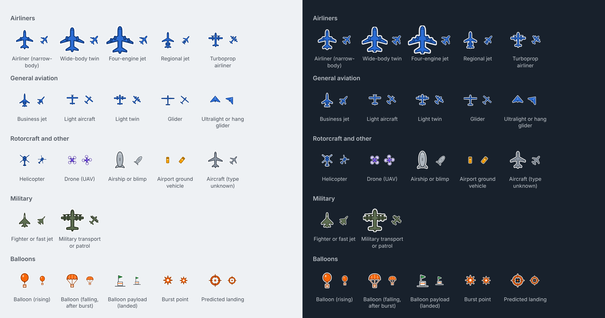

# Aircraft and balloon map icons

Map icons for aircraft and balloons, drawn in the same style as the
[marine set](../marine/README.md): a filled shape with a darker outline, a few
details and a light halo, on a 32 x 32 grid. The set is original Airframes
artwork.



## Files

| File | What it is |
| --- | --- |
| `svg/<key>.svg` | One 32 x 32 SVG per icon, in the default colors |
| `aircraft-icons.ts` | The module apps copy: icon list, `aircraftIconKey()` and `balloonIconKey()` classifiers, `aircraftIconSvg()` to recolor, `loadAircraftIconImages()` for MapLibre/Mapbox `addImage` |
| `aircraft-icons.js` | The same module as plain JavaScript (ES module) |
| `aircraft-icons.json` | Keys, labels, colors, sizes, ADS-B categories and rotate flags |
| `sprite/aircraft[@2x].{png,json}` | Mapbox/MapLibre sprite sheets (default colors) |
| `preview.png` | Every icon on light and dark backgrounds, at its relative size |

Aircraft point north. Turn them by track (or heading). Balloon icons stay
upright.

## Colors

Apps usually color aircraft by altitude or to suit the basemap, so aircraft
icons can be recolored: `aircraftIconSvg(key, fill)` swaps the fill and uses a
darker shade of it for the outline (or pass your own outline). Details are
translucent white or black, so they read on any fill. Balloon icons keep their
colors.

## Sizes

`scale` (and `aircraftIconScale(key)`) is the icon's size relative to a
narrow-body airliner: a four-engine jet is 1.4, a business jet 0.7, a light
aircraft 0.6, a drone 0.5. It is not a true size ratio, only enough to show
that some aircraft are bigger than others. Multiply the app's icon size by it.

## Choosing an icon

`aircraftIconKey({ type, category, military })` never throws:

1. **ICAO type designator** (`B738`, `A359`, `H145`, `GLID`), then its family
   prefix (`B73…`, `A34…`).
2. **ADS-B emitter category** (`A1` light, `A2` small, `A3`/`A4` large,
   `A5` heavy, `A6` high performance, `A7` rotorcraft, `B1` glider, `B2`
   lighter than air, `B4` ultralight, `B6` UAV, `C1`/`C2` surface vehicles).
3. The military flag (fighter), else `unknown`.

| Key | Examples |
| --- | --- |
| `airliner` | A320 family, 737, 757, MD-80, A220 |
| `widebody` | 767, 777, 787, A330, A350, MD-11 |
| `quad` | 747, A340, A380, An-124, C-17, KC-135 |
| `regional` | CRJ, E-Jets, ERJ, Fokker, Superjet |
| `turboprop` | ATR, Dash 8, Saab 340, Beech 1900 |
| `bizjet` | Citation, Gulfstream, Learjet, Falcon, Challenger |
| `light` | Cessna 172/182/208, Piper, Cirrus, PC-12, TBM |
| `light-twin` | Baron, Seneca, King Air, Cessna 310/414 |
| `glider`, `ultralight`, `airship` | `GLID`, `ULAC`, `SHIP`/`BALL` |
| `helicopter` | Airbus, Bell, Robinson, Sikorsky, AW139, V-22 |
| `fighter` | F-16, F-35, Typhoon, Rafale, trainers |
| `military-transport` | C-130, P-3, C-27J, E-2 |
| `drone` | MQ-9, RQ-4, ADS-B `B6` |
| `ground-vehicle` | ADS-B `C1`/`C2` |
| `unknown` | anything else |

`balloonIconKey({ verticalRate, landed })` picks `balloon` (rising),
`parachute` (falling after burst) or `landed`. `burst` and `landing`
(predicted landing) mark points on a balloon's track.

## Using it

Copy `aircraft-icons.ts` (or `.js`) into the app. In MapLibre or Mapbox GL:

```ts
import { loadAircraftIconImages, aircraftIconKey, aircraftIconScale } from './aircraft-icons';

for (const [key, image] of await loadAircraftIconImages({ fill: '#1f6feb' })) map.addImage(`ac-${key}`, image, { pixelRatio: 2 });
// per feature: icon = `ac-${key}`, size = 0.6 * aircraftIconScale(key), rotate = track
```

For several fills (altitude bands), load the images once per fill under
different ids. In Leaflet, use `aircraftIconSvg(key, color)` in an
`L.divIcon` and rotate the wrapper with CSS.

## Changing the icons

Edit `src/icons.mjs` (drawings, colors, sizes) or `src/classify.ts` (type
table and classifiers), then run `node aircraft/src/build.mjs` (Node 22.13 or
later) and copy `aircraft-icons.ts` to the apps again. The PNGs need the
`playwright` npm package where Node can resolve it from `aircraft/src/` and
its Chromium, as for the marine set.

The apps that use it: desktop-app, globe-solid, frontend-spa-vue2, xng
(dashboard and desktop) and airwaves-os-control.
