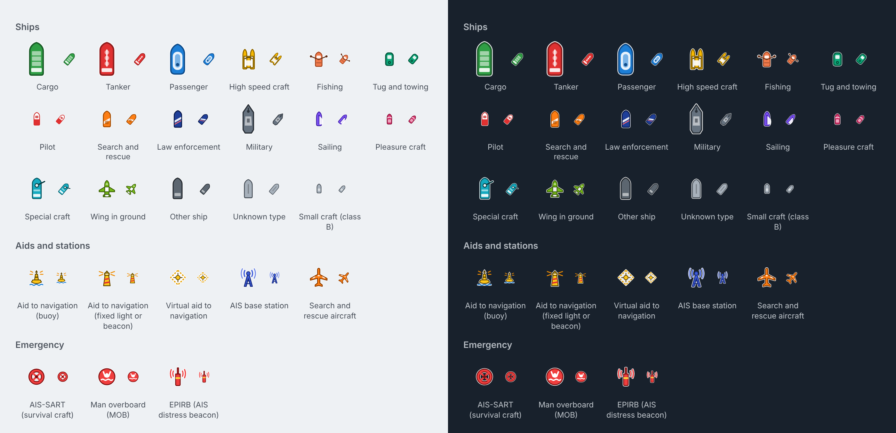

# Marine map icons

One icon for every kind of AIS target Airframes shows: each AIS ship type group,
aids to navigation (buoys, fixed lights and beacons, virtual aids), AIS base
stations, search and rescue aircraft, and the emergency beacons (AIS-SART, MOB,
EPIRB). The set is original Airframes artwork.



## Files

| File | What it is |
| --- | --- |
| `svg/<key>.svg` | One 32 x 32 SVG per icon, with a light halo so it reads on light, dark and satellite maps |
| `marine-icons.ts` | The module apps copy: icon list with inline SVG, `marineIconKey()` classifier, `loadMarineIconImages()` for MapLibre/Mapbox `addImage` |
| `marine-icons.js` | The same module as plain JavaScript (ES module) |
| `marine-icons.json` | Keys, labels, colors, AIS type codes and rotate flags |
| `sprite/marine[@2x].{png,json}` | Mapbox/MapLibre sprite sheets |
| `preview.png` | Every icon on light and dark backgrounds |

Ships and aircraft point north. Turn them by course over ground (or heading)
when `rotate` is true; leave stations, aids and beacons upright.

## Choosing an icon

`marineIconKey(target)` takes whatever is known about a target and never throws:

- **MMSI** (ITU-R M.585): `970` AIS-SART, `972` MOB, `974` EPIRB, `111` SAR
  aircraft, `99` aid to navigation, `98` craft of a parent ship, `00` base
  station. Numeric MMSIs that lost their leading zeros are padded back.
- **Ship type** (ITU-R M.1371 codes 0 to 99, or type text such as "Cargo",
  "Tanker - Hazard A", "Fishing vessel").
- **Aid to navigation type** (message 21, 1 to 19 fixed, 20 to 31 floating) and
  the virtual flag, or the stored form `aton:<aid type>[:virtual]`.
- **AIS message type** or **transponder class** (class B targets without a
  type get the small craft icon).

| Key | Selected by |
| --- | --- |
| `cargo` | 70-79 |
| `tanker` | 80-89 |
| `passenger` | 60-69 |
| `high-speed` | 40-49 |
| `fishing` | 30 |
| `tug` | 31, 32, 52 |
| `pilot` | 50 |
| `sar` | 51 |
| `law` | 55 |
| `military` | 35 |
| `sailing` | 36 |
| `pleasure` | 37 |
| `special` | 33, 34, 53, 54, 56-59 (dredging, diving, port tender, anti-pollution, medical) |
| `wig` | 20-29 |
| `other` | 90-99 and reserved codes |
| `unknown` | no type |
| `class-b` | class B without a type, MMSI 98 |
| `aton`, `aton-fixed`, `aton-virtual` | message 21 / MMSI 99 |
| `base-station` | message 4 or 11 / MMSI 00 |
| `sar-aircraft` | message 9 / MMSI 111 |
| `sart`, `mob`, `epirb` | MMSI 970, 972, 974 |

## Using it

Copy `marine-icons.ts` (or `.js`) into the app. In MapLibre or Mapbox GL:

```ts
import { loadMarineIconImages, marineIconKey, marineIconRotates } from './marine-icons';

for (const [key, image] of await loadMarineIconImages(32, 2)) map.addImage(`marine-${key}`, image, { pixelRatio: 2 });
// per feature: icon = `marine-${marineIconKey(v)}`, rotate = marineIconRotates(key) ? course : 0
// layout: { 'icon-image': ['get', 'icon'], 'icon-rotate': ['get', 'rotate'], 'icon-rotation-alignment': 'map' }
```

In Leaflet, use `MARINE_ICONS[key].svg` in an `L.divIcon` and rotate the
wrapper with CSS.

## Changing the icons

Edit `src/icons.mjs` (drawings, colors, codes) or `src/classify.ts` (the
classifier), then run `node marine/src/build.mjs` (Node 22.13 or later) and
copy `marine-icons.ts` to the apps again.

The PNGs (sprites and preview) need the `playwright` npm package where Node
can resolve it from `marine/src/` and its Chromium
(`npm install --no-save playwright && npx playwright install chromium`).
Without them the script still writes the SVG, JSON and modules, says it
skipped the PNGs, and leaves the old PNGs in place.

The apps that use it: desktop-app, globe-solid, xng (dashboard and
desktop) and airwaves-os-control.
